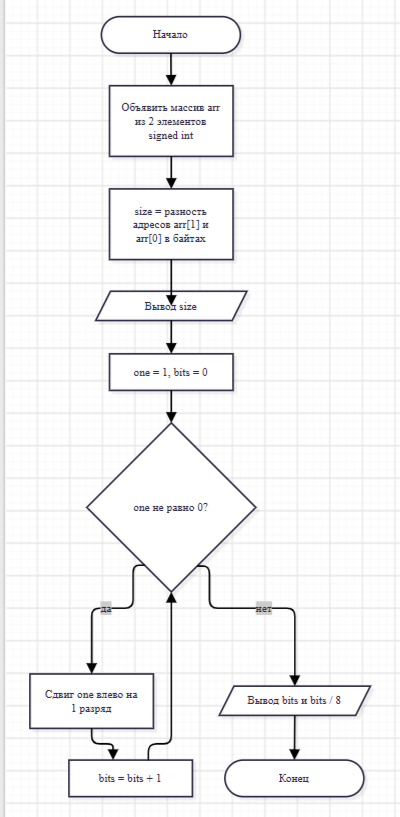

## Домашнее задание к лабораторной 12

### Вариант 11
#### Напишите программу, которая вычисляет размер основных типов данных в байтах: 1) char 2) short int 3) unsigned short int 4) int 5) unsigned char 6) wchar_t 7) long long int 8) size_t 9) float 10) double 11) signed int 12)!НЕЛЬЗЯ ПОЛЬЗОВАТЬСЯ sizeof  и КОНСТАНТАМИ ИЗ limits.h и float.h
```
#define _CRT_SECURE_NO_WARNINGS
#include <stdio.h>
#include <locale.h>

// Лабораторная 12, задание 5
// Побайтовый вывод чисел с помощью указателей

void print_bytes(void *p, int size);

int main()
{
    setlocale(LC_ALL, "Rus");

    // ----- программа из методички -----
    int x = 0x12345678;
    int *prt;
    unsigned char *a1, *a2, *a3, *a4;
    unsigned char *a;

    prt = &x;
    a = (unsigned char*)prt;   // указатель на первый байт числа

    a1 = a + 3;   // 4-й байт
    a2 = a + 2;
    a3 = a + 1;
    a4 = a;       // первый байт
    printf("%.2x\n%.2x\n%.2x\n%.2x\n", *a1, *a2, *a3, *a4);

    // 5.1 вывод о порядке байтов
    printf("\n5.1\n");
    if (*a4 == 0x78)
        printf("Первым в памяти лежит младший байт 78 - порядок little-endian (прямой)\n");
    else
        printf("Первым в памяти лежит старший байт 12 - порядок big-endian (обратный)\n");

    // 5.2 побайтовый вывод переменной любого типа
    printf("\n5.2\n");
    short s = 0x1234;
    double d = 2.5;
    printf("short 0x1234: ");
    print_bytes(&s, sizeof(s));
    printf("int 0x12345678: ");
    print_bytes(&x, sizeof(x));
    printf("double 2.5: ");
    print_bytes(&d, sizeof(d));

    // 5.3 число 12345.0 в разных типах
    printf("\n5.3\n");
    int xi = 12345;
    float xf = 12345.0f;
    double xd = 12345.0;
    printf("int    12345   : ");
    print_bytes(&xi, sizeof(xi));
    printf("float  12345.0 : ");
    print_bytes(&xf, sizeof(xf));
    printf("double 12345.0 : ");
    print_bytes(&xd, sizeof(xd));
    // Вывод: int хранится как обычное целое число, а float и double - в
    // экспоненциальном виде (знак, порядок, мантисса), поэтому коды разные,
    // а у double ещё и байт больше (8 вместо 4).

    return 0;
}

// выводит size байт переменной по адресу p, начиная с первого байта в памяти
void print_bytes(void *p, int size)
{
    unsigned char *b = (unsigned char*)p;
    int i;
    for (i = 0; i < size; i++)
        printf("%.2x ", b[i]);
    printf("\n");
}
```

### Вывод
#### Я научилась использовать указатели и узнала, что имя массива является адресом его первого элемента. Чтобы найти размер `signed int` без `sizeof`, я взяла два соседних элемента массива и вычла их адреса, предварительно приведя к типу `char*`. Тогда разность получается в байтах и равна 4. Для проверки я сдвигала единицу влево, пока она не пропала, и посчитала биты: получилось 32 бита, то есть 4 байта. Я поняла, что при вычитании указателей результат считается в элементах типа, а не в байтах, поэтому для байтов нужен `char*`. Оба способа дали одинаковый ответ, значит, программа работает верно.
